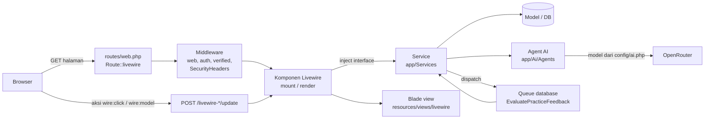
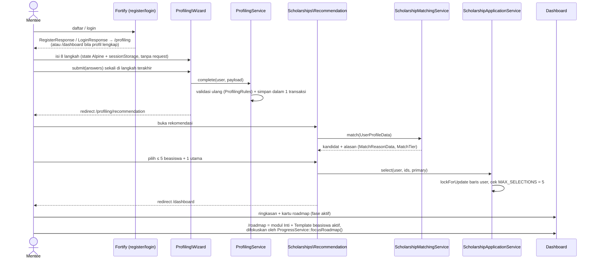
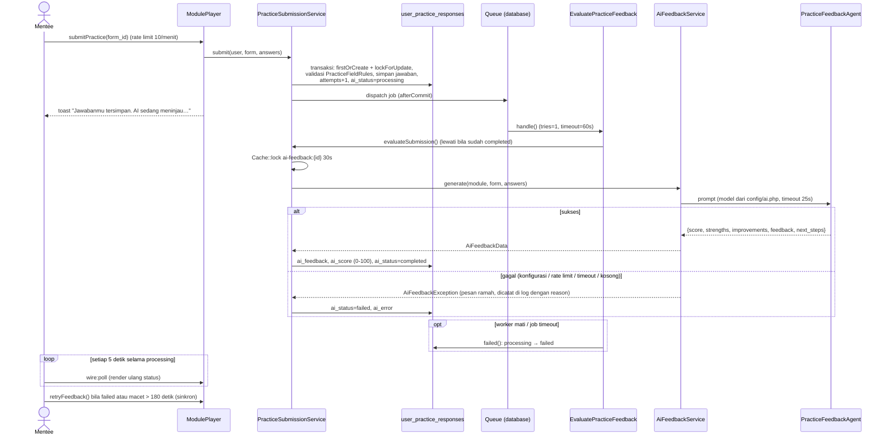

# Arsitektur Skular

Dokumen ini menjelaskan bagaimana request mengalir di Skular dan tiga alur utama: profiling, modul pembelajaran, dan penilaian AI. Untuk tabel lihat [`database.md`](database.md), untuk AI lihat [`ai-features.md`](ai-features.md), untuk route lihat [`routes.md`](routes.md).

## 1. Dua permukaan aplikasi

| Permukaan | Teknologi | Lokasi kode | Pengguna |
|---|---|---|---|
| Aplikasi mentee (publik) | Livewire 4 page components, Alpine, Blade | `app/Livewire`, `resources/views/livewire`, `routes/web.php` | Mentee (auth + verified) dan pengunjung (landing, FAQ) |
| Panel admin | Filament 5 di `/admin` | `app/Filament`, `app/Policies` | `super_admin`, `co_admin`, `staff_divisi` |

Keduanya memakai lapisan yang sama: **Service** di `app/Services` (di balik interface `app/Contracts`), **Model** Eloquent, dan **DTO** di `app/Data`.

## 2. Alur request



- Halaman mentee **tidak memakai controller**; controller hanya untuk Google OAuth, sitemap, health check, endpoint passkey, dan unduh bukti pendaftaran.
- Setiap aksi Livewire memvalidasi dan mengotorisasi ulang di server (state di browser tidak dipercaya).
- Panel admin melewati middleware Filament (`Authenticate`, `SetUpPanel:admin`) dan Shield policy di `app/Policies`.
- Bacaan kurikulum di-cache per versi dengan `ContentCache` (hanya scalar/array). Model Fase, Module, Scholarship, dan ModuleCoreSection memanggil `ContentCache::bump()` saat disimpan/dihapus.

## 3. Alur profiling → rekomendasi → roadmap



## 4. Alur modul pembelajaran

`app/Livewire/Learning/ModulePlayer.php` memutar satu modul. Daftar langkah datang dari `ModuleOutlineService::stepLabels()`; langkah `quick` dan `praktik` hanya muncul bila modul punya Quick Question / latihan aktif.

```mermaid
flowchart TD
    A[GET /modules/{module}] --> B{Modul published?}
    B -- tidak --> X404[404]
    B -- ya --> C{checkpointFor: terkunci<br/>atau di luar jalur?}
    C -- ya --> X403[AuthorizationException]
    C -- tidak --> O[Pembukaan<br/>tujuan, durasi, output]
    O --> P[Pahami<br/>Kata Pengantar → Inti Materi kolom<br/>→ Ringkasan & Insight]
    P --> Q[Quick Question<br/>Benar/Salah, dikoreksi sistem]
    Q --> PR[Praktik<br/>form dinamis + Brainstorming + AI Mentor]
    PR -->|submitPractice| S[(user_practice_responses<br/>status processing)]
    S --> J[[Job EvaluatePracticeFeedback]]
    J --> FB{ai_status}
    FB -- completed --> LBL[Label hasil AI<br/>Sangat baik/Baik/Cukup/Perlu diperbaiki]
    FB -- failed / macet > 3 menit --> RT[Tombol Nilai ulang]
    RT --> J
    LBL --> G{Gate checkpoint:<br/>semua form tersimpan<br/>dan selesai dinilai?}
    G -- belum --> PR
    G -- ya --> CP[Checkpoint<br/>Tandai modul selesai + feedback modul]
    CP -->|ProgressService::completeModule| N[Modul berikutnya terbuka]
```

Catatan:

- **Gate checkpoint** ditegakkan di server (`ModulePlayer::guardCheckpointSection()` untuk `mount`, `goToSection`, dan perubahan `?section=`; serta `confirmCheckpoint()` dan `saveModuleFeedback()`). Lapisan kedua ada di `ProgressService::completeModule()`: modul tidak bisa diselesaikan oleh pemanggil mana pun selama ada jawaban yang belum tersimpan atau belum berstatus `completed`. UI hanya mencerminkan status (langkah terkunci, tombol nonaktif, polling 5 detik selama penilaian).
- **AI Mentor** (`MentorChat`) tampil di langkah Praktik: saran pertanyaan admin (jawaban tim gratis) lalu chat LLM dengan kuota per modul (`MentorQuotaService`).
- **Brainstorming** menampilkan pertanyaan pemancing buatan admin; AI hanya menyusun kerangka dari jawaban mentee, tidak pernah menimpa jawaban praktik.
- Modul **Perpustakaan** dibuka dari `/library` dan tidak menghalangi jalur beasiswa.

## 5. Alur penilaian AI praktik



## 6. Otorisasi

| Lapisan | Mekanisme |
|---|---|
| Mentee | Middleware `auth` + `verified`; akses modul lewat `ProgressService::checkpointFor()` / `authorisedStatus()`; kepemilikan aplikasi beasiswa dicek di komponen/controller terkait |
| Admin | `User::canAccessPanel()` + Shield policy (`app/Policies`), permission `{Aksi}:{Model}` dari `RoleSeeder`; `super_admin` melewati semua cek (Gate, `define_via_gate`) |
| Draft konten | `Module::isPublished()`; draf → 404 di player dan disaring dari jalur belajar |
