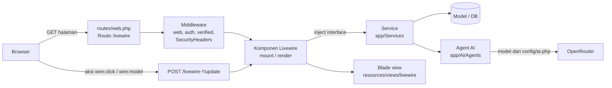
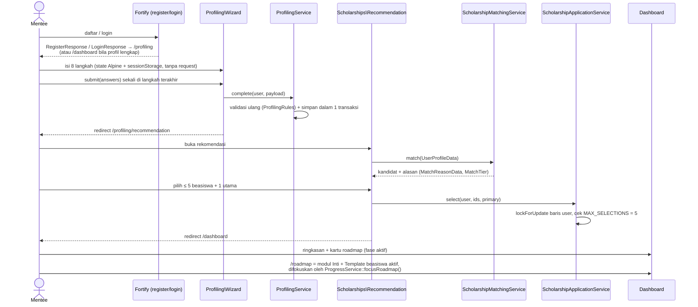
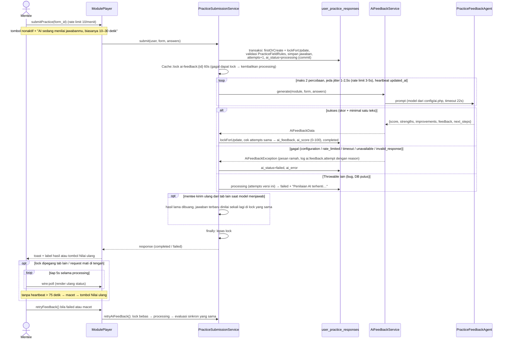
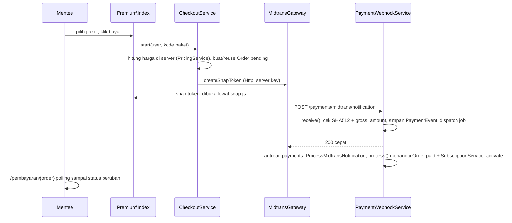

# Arsitektur Skular

Dokumen ini menjelaskan bagaimana request mengalir di Skular dan tiga alur utama: profiling, modul pembelajaran, dan penilaian AI. Untuk tabel lihat [`database.md`](database.md), untuk AI lihat [`ai-features.md`](ai-features.md), untuk route lihat [`routes.md`](routes.md).

## 1. Dua permukaan aplikasi

| Permukaan | Teknologi | Lokasi kode | Pengguna |
|---|---|---|---|
| Aplikasi mentee (publik) | Livewire 4 page components, Alpine, Blade | `app/Livewire`, `resources/views/livewire`, `routes/web.php` | Mentee (auth + verified) dan pengunjung (landing, FAQ) |
| Panel admin | Filament 5 di `/admin` | `app/Filament`, `app/Policies` | `super_admin`, `co_admin`, `staff_divisi` |

Keduanya memakai lapisan yang sama: **Service** di `app/Services` (di balik interface `app/Contracts`), **Model** Eloquent, dan **DTO** di `app/Data`.

## 2. Alur request



- Halaman mentee **tidak memakai controller**; controller hanya untuk Google OAuth, sitemap, health check, endpoint passkey, dan unduh bukti pendaftaran.
- Setiap aksi Livewire memvalidasi dan mengotorisasi ulang di server (state di browser tidak dipercaya).
- Panel admin melewati middleware Filament (`Authenticate`, `SetUpPanel:admin`) dan Shield policy di `app/Policies`.
- Bacaan kurikulum di-cache per versi dengan `ContentCache` (hanya scalar/array). Model Fase, Module, Scholarship, dan ModuleCoreSection memanggil `ContentCache::bump()` saat disimpan/dihapus.

## 3. Alur profiling → rekomendasi → roadmap



## 4. Alur modul pembelajaran

`app/Livewire/Learning/ModulePlayer.php` memutar satu modul. Daftar langkah datang dari `ModuleOutlineService::stepLabels()`; langkah `quick` dan `praktik` hanya muncul bila modul punya Quick Question / latihan aktif.

```mermaid
flowchart TD
    A[GET /modules/{module}] --> B{Modul published?}
    B -- tidak --> X404[404]
    B -- ya --> C{checkpointFor: terkunci<br/>atau di luar jalur?}
    C -- ya --> X403[AuthorizationException]
    C -- tidak --> O[Pembukaan<br/>tujuan, durasi, output]
    O --> P[Pahami<br/>Kata Pengantar → Inti Materi kolom<br/>→ Ringkasan & Insight]
    P --> Q[Quick Question<br/>Benar/Salah, dikoreksi sistem]
    Q --> PR[Praktik<br/>form dinamis + Brainstorming + AI Mentor]
    PR -->|submitPractice| S[(user_practice_responses<br/>status processing)]
    S --> J[[Penilaian AI sinkron<br/>PracticeSubmissionService]]
    J --> FB{ai_status}
    FB -- completed --> LBL[Label hasil AI<br/>Sangat baik/Baik/Cukup/Perlu diperbaiki]
    FB -- failed / macet > 75 detik --> RT[Tombol Nilai ulang]
    RT --> J
    LBL --> G{Gate checkpoint:<br/>semua form tersimpan<br/>dan selesai dinilai?}
    G -- belum --> PR
    G -- ya --> CP[Checkpoint<br/>Tandai modul selesai + feedback modul]
    CP -->|ProgressService::completeModule| N[Modul berikutnya terbuka]
```

Catatan:

- **Gate checkpoint** ditegakkan di server (`ModulePlayer::guardCheckpointSection()` untuk `mount`, `goToSection`, dan perubahan `?section=`; serta `confirmCheckpoint()` dan `saveModuleFeedback()`). Lapisan kedua ada di `ProgressService::completeModule()`: modul tidak bisa diselesaikan oleh pemanggil mana pun selama ada jawaban yang belum tersimpan atau belum berstatus `completed`. UI hanya mencerminkan status (langkah terkunci, tombol nonaktif selama request penilaian berjalan, polling 5 detik hanya bila penilaian dipegang request lain).
- **AI Mentor** (`MentorChat`) tampil di langkah Praktik: saran pertanyaan admin (jawaban tim gratis) lalu chat LLM dengan kuota per modul (`MentorQuotaService`).
- **Brainstorming** menampilkan pertanyaan pemancing buatan admin; AI hanya menyusun kerangka dari jawaban mentee, tidak pernah menimpa jawaban praktik.
- Modul **Perpustakaan** dibuka dari `/library` dan tidak menghalangi jalur beasiswa.

## 5. Alur penilaian AI praktik

Penilaian berjalan **sinkron di dalam request Livewire** (tanpa queue/worker). Penilaian pertama dan *Nilai ulang* memakai satu jalur: `PracticeSubmissionService::evaluate()`.



## 6. Otorisasi

| Lapisan | Mekanisme |
|---|---|
| Mentee | Middleware `auth` + `verified`; akses modul lewat `ProgressService::checkpointFor()` / `authorisedStatus()`; kepemilikan aplikasi beasiswa dicek di komponen/controller terkait |
| Admin | `User::canAccessPanel()` + Shield policy (`app/Policies`), permission `{Aksi}:{Model}` dari `RoleSeeder`; `super_admin` melewati semua cek (Gate, `define_via_gate`) |
| Draft konten | `Module::isPublished()`; draf → 404 di player dan disaring dari jalur belajar |

## 7. Alur pembayaran (Midtrans Snap)

Prepaid tanpa auto-renew. Browser tidak pernah menentukan harga atau status bayar.



Aturan: webhook satu-satunya sumber kebenaran, dan order berubah hanya di dalam job `ProcessMidtransNotification` (antrean `payments`, 5 percobaan dengan backoff, tidak berjalan bersamaan untuk order yang sama). Worker wajib hidup: `php artisan queue:work --queue=payments,reminders,default`. Jaring pengaman: `payments:requeue-stuck` tiap 5 menit. `paid` bersifat final (notifikasi ulang tidak memperpanjang dua kali); pembelian saat Pro aktif melanjutkan dari `active_until`. 

## 8. Paket Pro: aturan dan fitur

Semua batas Gratis vs Pro ada di `config/plans.php` dan hanya dibaca lewat `EntitlementService` (`can()`, `isPro()`, `reminderLimit()`). Pro yang berakhir dihitung Gratis; data tidak dihapus.

| Fitur | Gratis | Pro |
|---|---|---|
| Vault dokumen (`/vault`) | Terkunci (halaman tampil dengan tombol upgrade) | Sampai 50 file, 5 MB |
| Checklist berkas | Terkunci | Semua beasiswa pilihan |
| Reminder deadline email (H-7, H-3, H-1) | Beasiswa utama saja | Semua |

Reminder: `reminders:dispatch` (harian 07:00 WIB) mengantrekan `SendDeadlineReminder` per aplikasi di antrean `reminders`; `reminder_logs` mencegah kirim ganda. Belum ada WhatsApp.

Sengaja tidak dikunci: cek kecocokan dan rekomendasi (dipakai alur profiling dan batas 5 beasiswa) dan modul template (bagian roadmap). Keduanya tetap penuh untuk Gratis.

Referral: kode diketik di `/premium` (atau `?kode=`), divalidasi `ReferralService::apply()` di server saat checkout: hanya paket 12 bulan selama harga launching, 10% dari harga launching (Rp74.500 jadi Rp67.050), tidak boleh kode sendiri, satu akun satu kali (order paid dengan referrer). Order menyimpan `promo_code`, `referrer_user_id`, `discount_amount`. Pengingat Pro berakhir (H-7 dan H-1): `subscriptions:remind-expiry` harian 07:10 WIB mengantrekan `SendProExpiryReminder` (antrean `reminders`).

## 9. Panel admin pembayaran

Grup menu **Pembayaran** di `/admin`: Paket Pro (edit harga dan status jual, tanpa buat atau hapus), Pesanan (hanya baca), Langganan Pro (beri Pro manual atau ubah tanggal berakhir), Notifikasi Midtrans (log mentah, aksi "Antrekan ulang" untuk yang belum diproses). Widget `PaymentStats` di dashboard: pendapatan 30 hari (sebelum biaya Midtrans), pesanan lunas, Pro aktif, notifikasi tertahan. Izin dari `RoleSeeder`: `co_admin` membaca pesanan, mengedit harga, mengelola langganan; `staff_divisi` tidak punya akses; `super_admin` semuanya. Tanggal akhir promo launching tetap di `PRICING_LAUNCHING_UNTIL`, bukan di panel.
