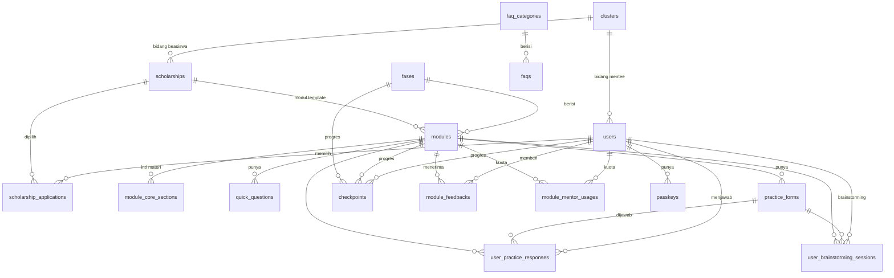

# Database Skular

Sumber: migration di `database/migrations` (dijalankan pada SQLite) dan relasi di `app/Models`. Tipe kolom di bagian 3 adalah tipe hasil migration pada SQLite; di MySQL/PostgreSQL production nama tipenya sedikit berbeda (mis. `json` → `json`, di SQLite tampil `text`). Tabel framework (`migrations`, `cache*`, `jobs`, `job_batches`, `failed_jobs`, `sessions`, `password_reset_tokens`) tidak dicantumkan.

> Aturan: migration hanya boleh **additive**. Jangan mengubah migration lama; buat migration baru. Uji di salinan data sebelum production.

## 1. ERD (tabel domain)

Role & permission memakai tabel spatie/laravel-permission: `roles`, `permissions`, `model_has_roles`, `model_has_permissions`, `role_has_permissions`.

## 2. Catatan per tabel (aturan yang tidak terlihat dari skema)

| Tabel | Catatan |
|---|---|
| `users` | Akun mentee dan admin. Kolom profiling (`level`, `age`, `gpa`, `has_sktm`, `desired_level`, `desired_location`, `cluster_id`, `phone`, `profile_completed_at`) diisi sekali oleh `ProfilingService::complete()`. Admin = user dengan role Shield; `canAccessPanel()` menolak mentee. |
| `scholarships` | Katalog beasiswa. `status` (`draft`/`active`/`closed`/`archived`): hanya `active` & `closed` yang tampil ke mentee. `link` = tautan sumber resmi. `key_benefits`, `values_sought` = JSON list. `image_path` = gambar kartu opsional di disk `public` (bukan logo penyelenggara, lihat aturan 10 AGENTS.md); upload ≤5 MB di-resize ke WebP ≤512 px dan file asli dibuang; file lama dihapus saat diganti. Menolak `delete()` bila sudah dipilih mentee. |
| `scholarship_applications` | Pilihan beasiswa mentee: maks 5 per user (`ScholarshipApplicationService::MAX_SELECTIONS`), unique `(user_id, scholarship_id)`, satu `is_primary`. Status `selected → submitted → result_reported` + `result`. Bukti pendaftaran di disk `local` (privat). |
| `fases` | Pengelompokan modul; urutan fase menentukan roadmap. Menolak `delete()` bila salah satu modulnya punya histori mentee. |
| `modules` | Tiga atribut berbeda: `type` (format penyajian, kolom lama), `category` (`inti`/`template`/`perpustakaan`), `content_status` (`draft`/`published`). `scholarship_id` hanya untuk `template` (dikosongkan otomatis untuk kategori lain). JSON: `insights` (list string), `brainstorming_questions`, `mentor_suggestions` (`[{question, answer|null}]`, maks 5). `inti_material` = teks Inti Materi lama (fallback bila belum ada `module_core_sections`). `ai_knowledge` = rubrik/basis pengetahuan untuk AI. Menolak `delete()` bila punya checkpoint/jawaban praktik. |
| `module_core_sections` | Kolom Inti Materi (subjudul + isi), urut `ordering`. Dikelola lewat Repeater di editor modul. |
| `quick_questions` | Pernyataan Benar/Salah (`answer` boolean) + `explanation`, dikoreksi sistem di langkah Quick Question. |
| `practice_forms` | Latihan praktik. `fields` = skema JSON pertanyaan (`name`, `label`, `type`, `required`, `placeholder`, `help_text`, `options`). `include_in_cv` + `cv_ordering` untuk halaman CV. |
| `user_practice_responses` | Jawaban praktik, **satu baris per (user, practice_form)** (unique). Resubmit memperbarui baris dan menambah `attempts`. `ai_status` (`pending`/`processing`/`completed`/`failed`), `ai_feedback` (JSON), `ai_score` (0–100, hanya untuk admin; mentee melihat label), `ai_error`. |
| `checkpoints` | Progres modul per mentee (`locked`/`available`/`in_progress`/`completed`), `score` = rata-rata skor AI saat modul diselesaikan. Progres modul Inti dibagi lintas beasiswa. |
| `module_feedbacks` | Feedback mentee untuk modul (checklist `ratings` JSON + `suggestion`), satu per user per modul. Nama tabel di-set manual (`$table`). |
| `module_mentor_usages` | Kuota AI Mentor: `used` per `(user_id, module_id)` (unique). Direservasi dengan `lockForUpdate` sebelum memanggil LLM, dikurangi lagi bila gagal. |
| `user_brainstorming_sessions` | Jawaban brainstorming + kerangka AI, satu baris per (user, practice_form) (unique), agar bisa dilanjutkan di perangkat lain. |
| `twibbon_templates` | Gambar template + `placements` (JSON posisi teks) untuk generator twibbon. |
| `faq_categories`, `faqs` | FAQ publik; kategori berisi FAQ menolak `delete()`. |
| `clusters` | Bidang studi untuk profiling & pencocokan. |
| `passkeys` | Kredensial WebAuthn (Laravel passkeys). |
| `agent_conversations`, `agent_conversation_messages` | Dibuat oleh migration laravel/ai. **Tidak dipakai** kode aplikasi saat ini (riwayat chat AI Mentor hanya di state komponen). |

## 3. Kolom per tabel

### `agent_conversation_messages`

| Kolom | Tipe | Null | Default |
|---|---|---|---|
| `id` | varchar |  |  |
| `conversation_id` | varchar |  |  |
| `participant_type` | varchar | ya |  |
| `participant_id` | integer | ya |  |
| `agent` | varchar |  |  |
| `role` | varchar |  |  |
| `content` | text |  |  |
| `attachments` | text |  |  |
| `steps` | text |  |  |
| `usage` | text |  |  |
| `meta` | text |  |  |
| `status` | varchar |  |  |
| `created_at` | datetime | ya |  |
| `updated_at` | datetime | ya |  |

### `agent_conversations`

| Kolom | Tipe | Null | Default |
|---|---|---|---|
| `id` | varchar |  |  |
| `participant_type` | varchar | ya |  |
| `participant_id` | integer | ya |  |
| `title` | varchar |  |  |
| `created_at` | datetime | ya |  |
| `updated_at` | datetime | ya |  |

### `checkpoints`

| Kolom | Tipe | Null | Default |
|---|---|---|---|
| `id` | integer |  |  |
| `user_id` | integer |  |  |
| `module_id` | integer |  |  |
| `fase_id` | integer |  |  |
| `status` | varchar |  | 'available' |
| `score` | integer | ya |  |
| `attempts` | integer |  | '0' |
| `metadata` | text | ya |  |
| `available_at` | datetime | ya |  |
| `started_at` | datetime | ya |  |
| `completed_at` | datetime | ya |  |
| `created_at` | datetime | ya |  |
| `updated_at` | datetime | ya |  |

FK: `fase_id` → `fases.id` (on delete cascade); `module_id` → `modules.id` (on delete cascade); `user_id` → `users.id` (on delete cascade)

Unique: `(user_id, module_id)`

### `clusters`

| Kolom | Tipe | Null | Default |
|---|---|---|---|
| `id` | integer |  |  |
| `name` | varchar |  |  |
| `label` | varchar |  |  |
| `description` | varchar | ya |  |
| `icon` | varchar | ya |  |
| `ordering` | integer |  | '0' |
| `is_active` | tinyint |  | '1' |
| `created_at` | datetime | ya |  |
| `updated_at` | datetime | ya |  |

Unique: `(name)`

### `faq_categories`

| Kolom | Tipe | Null | Default |
|---|---|---|---|
| `id` | integer |  |  |
| `name` | varchar |  |  |
| `slug` | varchar |  |  |
| `description` | text | ya |  |
| `sort_order` | integer |  | '0' |
| `is_active` | tinyint |  | '1' |
| `created_at` | datetime | ya |  |
| `updated_at` | datetime | ya |  |

Unique: `(slug)`

### `faqs`

| Kolom | Tipe | Null | Default |
|---|---|---|---|
| `id` | integer |  |  |
| `faq_category_id` | integer |  |  |
| `question` | text |  |  |
| `answer` | text |  |  |
| `is_published` | tinyint |  | '0' |
| `is_featured` | tinyint |  | '0' |
| `sort_order` | integer |  | '0' |
| `published_at` | datetime | ya |  |
| `created_at` | datetime | ya |  |
| `updated_at` | datetime | ya |  |

FK: `faq_category_id` → `faq_categories.id` (on delete restrict)

### `fases`

| Kolom | Tipe | Null | Default |
|---|---|---|---|
| `id` | integer |  |  |
| `title` | varchar |  |  |
| `subtitle` | varchar | ya |  |
| `fase_order` | integer |  | '0' |
| `short_description` | text | ya |  |
| `created_at` | datetime | ya |  |
| `updated_at` | datetime | ya |  |

### `model_has_permissions`

| Kolom | Tipe | Null | Default |
|---|---|---|---|
| `permission_id` | integer |  |  |
| `model_type` | varchar |  |  |
| `model_id` | integer |  |  |

FK: `permission_id` → `permissions.id` (on delete cascade)

### `model_has_roles`

| Kolom | Tipe | Null | Default |
|---|---|---|---|
| `role_id` | integer |  |  |
| `model_type` | varchar |  |  |
| `model_id` | integer |  |  |

FK: `role_id` → `roles.id` (on delete cascade)

### `module_core_sections`

| Kolom | Tipe | Null | Default |
|---|---|---|---|
| `id` | integer |  |  |
| `module_id` | integer |  |  |
| `subtitle` | varchar |  |  |
| `body` | text |  |  |
| `ordering` | integer |  | '0' |
| `created_at` | datetime | ya |  |
| `updated_at` | datetime | ya |  |

FK: `module_id` → `modules.id` (on delete cascade)

### `module_feedbacks`

| Kolom | Tipe | Null | Default |
|---|---|---|---|
| `id` | integer |  |  |
| `user_id` | integer |  |  |
| `module_id` | integer |  |  |
| `ratings` | text | ya |  |
| `suggestion` | text | ya |  |
| `created_at` | datetime | ya |  |
| `updated_at` | datetime | ya |  |

FK: `module_id` → `modules.id` (on delete cascade); `user_id` → `users.id` (on delete cascade)

Unique: `(user_id, module_id)`

### `module_mentor_usages`

| Kolom | Tipe | Null | Default |
|---|---|---|---|
| `id` | integer |  |  |
| `user_id` | integer |  |  |
| `module_id` | integer |  |  |
| `used` | integer |  | '0' |
| `created_at` | datetime | ya |  |
| `updated_at` | datetime | ya |  |

FK: `module_id` → `modules.id` (on delete cascade); `user_id` → `users.id` (on delete cascade)

Unique: `(user_id, module_id)`

### `modules`

| Kolom | Tipe | Null | Default |
|---|---|---|---|
| `id` | integer |  |  |
| `fase_id` | integer |  |  |
| `title` | varchar |  |  |
| `modul_order` | integer |  | '0' |
| `summary_material` | text | ya |  |
| `insights` | text | ya |  |
| `inti_material` | text | ya |  |
| `type` | varchar |  | 'reading' |
| `duration` | integer | ya |  |
| `goal` | text | ya |  |
| `link_video` | varchar | ya |  |
| `ai_knowledge` | text | ya |  |
| `created_at` | datetime | ya |  |
| `updated_at` | datetime | ya |  |
| `introduction` | text | ya |  |
| `category` | varchar |  | 'inti' |
| `scholarship_id` | integer | ya |  |
| `content_status` | varchar |  | 'draft' |
| `brainstorming_questions` | text | ya |  |
| `mentor_suggestions` | text | ya |  |

FK: `scholarship_id` → `scholarships.id` (on delete restrict); `fase_id` → `fases.id` (on delete cascade)

### `passkeys`

| Kolom | Tipe | Null | Default |
|---|---|---|---|
| `id` | integer |  |  |
| `user_id` | integer |  |  |
| `name` | varchar |  |  |
| `credential_id` | varchar |  |  |
| `credential` | text |  |  |
| `last_used_at` | datetime | ya |  |
| `created_at` | datetime | ya |  |
| `updated_at` | datetime | ya |  |

FK: `user_id` → `users.id` (on delete cascade)

Unique: `(credential_id)`

### `permissions`

| Kolom | Tipe | Null | Default |
|---|---|---|---|
| `id` | integer |  |  |
| `name` | varchar |  |  |
| `guard_name` | varchar |  |  |
| `created_at` | datetime | ya |  |
| `updated_at` | datetime | ya |  |

Unique: `(name, guard_name)`

### `practice_forms`

| Kolom | Tipe | Null | Default |
|---|---|---|---|
| `id` | integer |  |  |
| `module_id` | integer |  |  |
| `title` | varchar |  |  |
| `description` | text | ya |  |
| `fields` | text | ya |  |
| `ordering` | integer |  | '0' |
| `is_active` | tinyint |  | '1' |
| `include_in_cv` | tinyint |  | '0' |
| `cv_ordering` | integer |  | '0' |
| `created_at` | datetime | ya |  |
| `updated_at` | datetime | ya |  |

FK: `module_id` → `modules.id` (on delete cascade)

### `quick_questions`

| Kolom | Tipe | Null | Default |
|---|---|---|---|
| `id` | integer |  |  |
| `module_id` | integer |  |  |
| `question` | text |  |  |
| `answer` | tinyint |  | '1' |
| `explanation` | text | ya |  |
| `ordering` | integer |  | '0' |
| `is_active` | tinyint |  | '1' |
| `created_at` | datetime | ya |  |
| `updated_at` | datetime | ya |  |

FK: `module_id` → `modules.id` (on delete cascade)

### `role_has_permissions`

| Kolom | Tipe | Null | Default |
|---|---|---|---|
| `permission_id` | integer |  |  |
| `role_id` | integer |  |  |

FK: `role_id` → `roles.id` (on delete cascade); `permission_id` → `permissions.id` (on delete cascade)

### `roles`

| Kolom | Tipe | Null | Default |
|---|---|---|---|
| `id` | integer |  |  |
| `name` | varchar |  |  |
| `guard_name` | varchar |  |  |
| `created_at` | datetime | ya |  |
| `updated_at` | datetime | ya |  |

Unique: `(name, guard_name)`

### `scholarship_applications`

| Kolom | Tipe | Null | Default |
|---|---|---|---|
| `id` | integer |  |  |
| `user_id` | integer |  |  |
| `scholarship_id` | integer |  |  |
| `status` | varchar |  | 'selected' |
| `is_primary` | tinyint |  | '0' |
| `selected_at` | datetime | ya |  |
| `submitted_at` | datetime | ya |  |
| `submission_proof` | varchar | ya |  |
| `submission_note` | text | ya |  |
| `submission_confirmed_at` | datetime | ya |  |
| `result` | varchar | ya |  |
| `result_reported_at` | datetime | ya |  |
| `metadata` | text | ya |  |
| `created_at` | datetime | ya |  |
| `updated_at` | datetime | ya |  |
| `learning_completed_at` | datetime | ya |  |

FK: `scholarship_id` → `scholarships.id` (on delete cascade); `user_id` → `users.id` (on delete cascade)

Unique: `(user_id, scholarship_id)`

### `scholarships`

| Kolom | Tipe | Null | Default |
|---|---|---|---|
| `id` | integer |  |  |
| `scholarship_name` | varchar |  |  |
| `institution` | varchar | ya |  |
| `level` | varchar |  |  |
| `location` | varchar | ya |  |
| `scope` | varchar | ya |  |
| `sktm_require` | tinyint |  | '0' |
| `minimum_value` | numeric | ya |  |
| `maximum_age` | integer | ya |  |
| `opening_date` | date | ya |  |
| `closing_date` | date | ya |  |
| `estimated_quota` | integer | ya |  |
| `link` | varchar | ya |  |
| `image_path` | varchar | ya |  |
| `verification_date` | date | ya |  |
| `note` | text | ya |  |
| `status` | varchar |  | 'draft' |
| `created_at` | datetime | ya |  |
| `updated_at` | datetime | ya |  |
| `cluster_id` | integer | ya |  |
| `key_benefits` | text | ya |  |
| `values_sought` | text | ya |  |

### `twibbon_templates`

| Kolom | Tipe | Null | Default |
|---|---|---|---|
| `id` | integer |  |  |
| `name` | varchar |  |  |
| `description` | text | ya |  |
| `image_path` | varchar |  |  |
| `font_path` | varchar | ya |  |
| `placements` | text | ya |  |
| `is_active` | tinyint |  | '1' |
| `ordering` | integer |  | '0' |
| `created_at` | datetime | ya |  |
| `updated_at` | datetime | ya |  |

### `user_brainstorming_sessions`

| Kolom | Tipe | Null | Default |
|---|---|---|---|
| `id` | integer |  |  |
| `user_id` | integer |  |  |
| `module_id` | integer |  |  |
| `practice_form_id` | integer |  |  |
| `answers` | text | ya |  |
| `outline` | text | ya |  |
| `summary` | text | ya |  |
| `created_at` | datetime | ya |  |
| `updated_at` | datetime | ya |  |

FK: `practice_form_id` → `practice_forms.id` (on delete cascade); `module_id` → `modules.id` (on delete cascade); `user_id` → `users.id` (on delete cascade)

Unique: `(user_id, practice_form_id)`

### `user_practice_responses`

| Kolom | Tipe | Null | Default |
|---|---|---|---|
| `id` | integer |  |  |
| `user_id` | integer |  |  |
| `module_id` | integer |  |  |
| `practice_form_id` | integer |  |  |
| `answers` | text |  |  |
| `ai_feedback` | text | ya |  |
| `ai_score` | integer | ya |  |
| `ai_status` | varchar |  | 'pending' |
| `ai_error` | text | ya |  |
| `attempts` | integer |  | '1' |
| `submitted_at` | datetime | ya |  |
| `created_at` | datetime | ya |  |
| `updated_at` | datetime | ya |  |

FK: `practice_form_id` → `practice_forms.id` (on delete cascade); `module_id` → `modules.id` (on delete cascade); `user_id` → `users.id` (on delete cascade)

Unique: `(user_id, practice_form_id)`

### `users`

| Kolom | Tipe | Null | Default |
|---|---|---|---|
| `id` | integer |  |  |
| `name` | varchar |  |  |
| `email` | varchar |  |  |
| `email_verified_at` | datetime | ya |  |
| `password` | varchar |  |  |
| `remember_token` | varchar | ya |  |
| `created_at` | datetime | ya |  |
| `updated_at` | datetime | ya |  |
| `two_factor_secret` | text | ya |  |
| `two_factor_recovery_codes` | text | ya |  |
| `two_factor_confirmed_at` | datetime | ya |  |
| `google_id` | varchar | ya |  |
| `avatar_url` | varchar | ya |  |
| `level` | varchar | ya |  |
| `age` | integer | ya |  |
| `gpa` | numeric | ya |  |
| `has_sktm` | tinyint | ya |  |
| `desired_level` | varchar | ya |  |
| `desired_location` | varchar | ya |  |
| `cluster_id` | integer | ya |  |
| `phone` | varchar | ya |  |
| `subscription` | varchar | ya |  |
| `profile_completed_at` | datetime | ya |  |

Unique: `(email)`; `(google_id)`

